

<picture>
  <source media="(max-width: 640px) and (prefers-color-scheme: light)" srcset="assets/hero-mobile-light.svg">
  <source media="(max-width: 640px)" srcset="assets/hero-mobile-dark.svg">
  <source media="(prefers-color-scheme: light)" srcset="assets/hero-light.svg">
  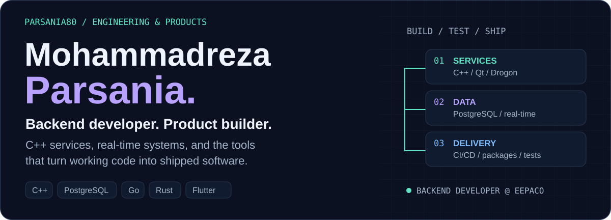
</picture>

  
  
  
  

  <a href="#selected-work">Selected work</a> &nbsp; / &nbsp;
  <a href="#engineering-at-forg">Engineering at FORG</a> &nbsp; / &nbsp;
  <a href="#research">Research</a> &nbsp; / &nbsp;
  <a href="#stack">Stack</a> &nbsp; / &nbsp;
  <a href="#activity">Activity</a> &nbsp; / &nbsp;
  <a href="#lets-connect">Contact</a>

I’m **Mohammadreza Parsania**, a backend developer at **EEPACO**, working on **FORG**, a mobile device management platform. My work spans C++ services, PostgreSQL, real-time communication, testing, and the tooling that gets software onto servers.

Outside my company work, I build products of my own: **Daily Planner** with Flutter, **FluxGet** with Go, and **parsBackUp** with Rust. I also publish my master’s research on hybrid group key exchange and adaptive TreeKEM.

## Engineering at FORG

**Backend developer at EEPACO** · [FORG](https://forgco.ir/) · Private company project

I build and improve the backend, device server, and the workflows that test and ship FORG. My contributions span six areas:

<!-- FORG:START -->

<picture><source media="(max-width: 640px) and (prefers-color-scheme: light)" srcset="assets/forg/backend-mobile-light.svg"><source media="(max-width: 640px)" srcset="assets/forg/backend-mobile-dark.svg"><source media="(prefers-color-scheme: light)" srcset="assets/forg/backend-light.svg">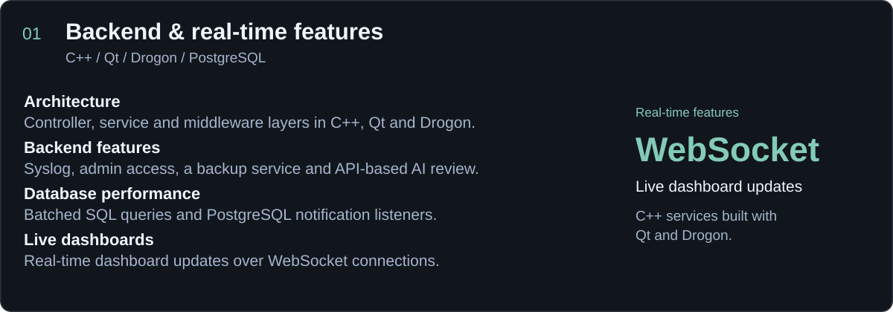</picture>

<picture><source media="(max-width: 640px) and (prefers-color-scheme: light)" srcset="assets/forg/server-mobile-light.svg"><source media="(max-width: 640px)" srcset="assets/forg/server-mobile-dark.svg"><source media="(prefers-color-scheme: light)" srcset="assets/forg/server-light.svg">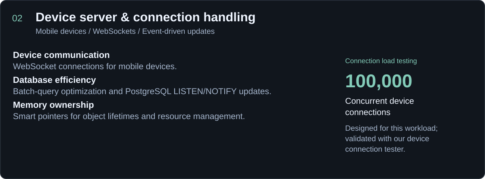</picture>

<picture><source media="(max-width: 640px) and (prefers-color-scheme: light)" srcset="assets/forg/delivery-mobile-light.svg"><source media="(max-width: 640px)" srcset="assets/forg/delivery-mobile-dark.svg"><source media="(prefers-color-scheme: light)" srcset="assets/forg/delivery-light.svg"></picture>

<picture><source media="(max-width: 640px) and (prefers-color-scheme: light)" srcset="assets/forg/testing-mobile-light.svg"><source media="(max-width: 640px)" srcset="assets/forg/testing-mobile-dark.svg"><source media="(prefers-color-scheme: light)" srcset="assets/forg/testing-light.svg">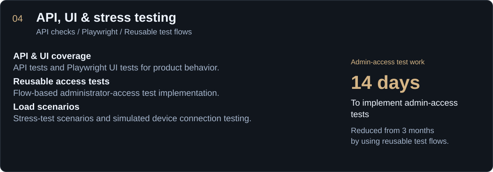</picture>

<picture><source media="(max-width: 640px) and (prefers-color-scheme: light)" srcset="assets/forg/deployment-mobile-light.svg"><source media="(max-width: 640px)" srcset="assets/forg/deployment-mobile-dark.svg"><source media="(prefers-color-scheme: light)" srcset="assets/forg/deployment-light.svg">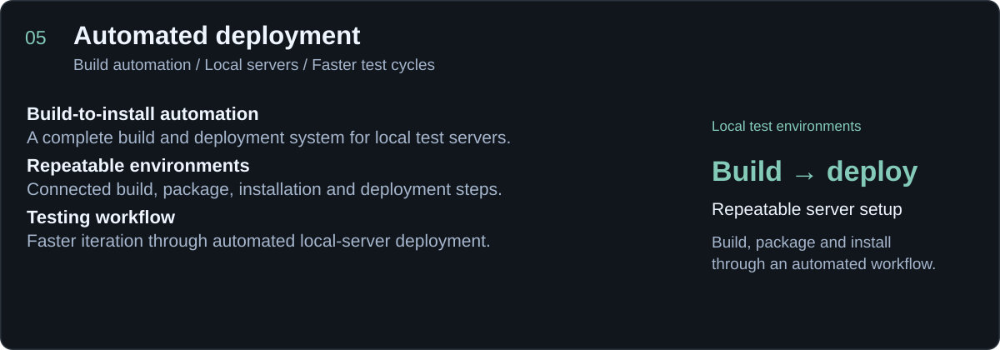</picture>

<picture><source media="(max-width: 640px) and (prefers-color-scheme: light)" srcset="assets/forg/licensing-mobile-light.svg"><source media="(max-width: 640px)" srcset="assets/forg/licensing-mobile-dark.svg"><source media="(prefers-color-scheme: light)" srcset="assets/forg/licensing-light.svg">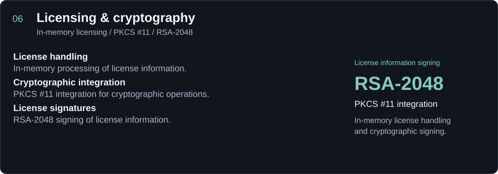</picture>

<!-- FORG:END -->

## Selected work

  <a href="https://forgco.ir/"><picture><source media="(max-width: 640px) and (prefers-color-scheme: light)" srcset="assets/forg-mobile-light.svg"><source media="(max-width: 640px)" srcset="assets/forg-mobile-dark.svg"><source media="(prefers-color-scheme: light)" srcset="assets/forg-light.svg">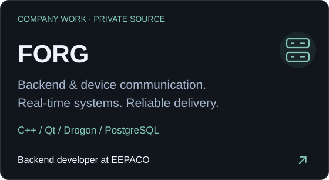</picture></a> &nbsp;
  <a href="https://myket.ir/app/com.parsania.roozchin"><picture><source media="(max-width: 640px) and (prefers-color-scheme: light)" srcset="assets/planner-mobile-light.svg"><source media="(max-width: 640px)" srcset="assets/planner-mobile-dark.svg"><source media="(prefers-color-scheme: light)" srcset="assets/planner-light.svg">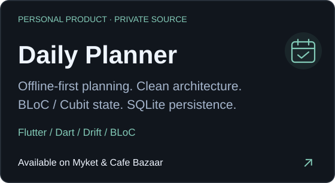</picture></a>

  <a href="https://github.com/Parsania80/FluxGet"><picture><source media="(max-width: 640px) and (prefers-color-scheme: light)" srcset="assets/fluxget-mobile-light.svg"><source media="(max-width: 640px)" srcset="assets/fluxget-mobile-dark.svg"><source media="(prefers-color-scheme: light)" srcset="assets/fluxget-light.svg">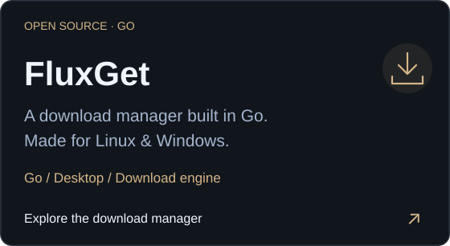</picture></a> &nbsp;
  <a href="https://github.com/Parsania80/parsBackUp"><picture><source media="(max-width: 640px) and (prefers-color-scheme: light)" srcset="assets/backup-mobile-light.svg"><source media="(max-width: 640px)" srcset="assets/backup-mobile-dark.svg"><source media="(prefers-color-scheme: light)" srcset="assets/backup-light.svg">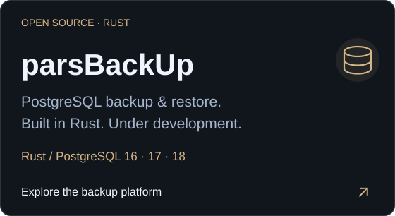</picture></a>

Also explore my [open-source master’s research in hybrid MLS and TreeKEM](#research).

### FORG · Backend developer at EEPACO

**Private company project** · [Open FORG](https://forgco.ir/)

I develop the backend and device communication server, with responsibilities across access control, database performance, live dashboards, delivery automation, and testing. See the engineering panels above for the implementation work and validation results.

### Daily Planner · Owner & developer

**Private personal product** · [Myket](https://myket.ir/app/com.parsania.roozchin) · [Cafe Bazaar](https://cafebazaar.ir/app/com.parsania.roozchin)

An **offline-first Flutter/Dart planner** for tasks, recurring routines, projects, and notes, available as **Roozchin** on Myket and Cafe Bazaar.

- **Architecture & state:** clean architecture with presentation, domain, and data layers; repository abstractions; BLoC/Cubit state management; GetIt dependency injection.
- **Persistence:** Drift over SQLite for local storage, relational task hierarchies, and database migrations.
- **Planning logic:** recurring task expansion, nested projects and folders, date-based planning, search, and bulk operations.
- **Native Android integration:** scheduled reminders, notification actions, and reminder reconciliation across app lifecycle changes.
- **Localization & UX:** Persian/English localization, RTL layouts, Jalali/Gregorian calendars, and persistent theme and time-format preferences.
- **Product engineering:** backup/restore workflows, separate store billing adapters, and Android release variants for Myket and Cafe Bazaar.
- **Testing:** unit, BLoC, widget, integration, architecture-boundary, and golden-image tests.

### FluxGet · Open source

**Go · Linux & Windows** · [Source](https://github.com/Parsania80/FluxGet) · [Releases](https://github.com/Parsania80/FluxGet/releases)

A desktop download manager for managing multiple downloads, pausing and resuming transfers, and controlling download speeds. I work on the download engine, desktop experience, browser integration, and native packaging.

### parsBackUp · Open source

**Rust · PostgreSQL 16 / 17 / 18** · [Source](https://github.com/Parsania80/parsBackUp)

A PostgreSQL backup and restore platform I’m developing in Rust, with work on backup verification, selective restore, encrypted artifacts, and recovery workflows. The current development CLI is tested against synthetic databases across PostgreSQL 16, 17, and 18; the production service is still in progress.

## Research

<a href="https://github.com/Parsania80/Master-Hybrid-MLS"><picture><source media="(max-width: 640px) and (prefers-color-scheme: light)" srcset="assets/research-mobile-light.svg"><source media="(max-width: 640px)" srcset="assets/research-mobile-dark.svg"><source media="(prefers-color-scheme: light)" srcset="assets/research-light.svg">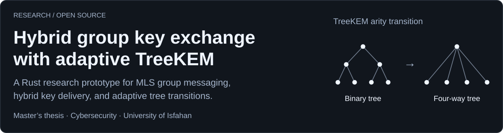</picture></a>

### Master-Hybrid-MLS · Master’s thesis

**Open-source research · Rust · MLS / TreeKEM** · [Repository](https://github.com/Parsania80/Master-Hybrid-MLS) · [Thesis PDF](https://github.com/Parsania80/Master-Hybrid-MLS/blob/main/%D9%BE%D8%A7%DB%8C%D8%A7%D9%86%20%D9%86%D8%A7%D9%85%D9%87/Thesis.pdf) · [Current implementation](https://github.com/Parsania80/Master-Hybrid-MLS/tree/main/implementation/new)

My master’s research in cybersecurity at the **University of Isfahan**, titled **Hybrid Group Key Exchange based on TreeKEM**, explores hybrid classical/post-quantum key delivery and adaptive tree structures for secure group messaging.

- **Protocol research:** hybrid path-secret delivery combining classical HPKE with an educational multi-recipient mKyber implementation.
- **Adaptive TreeKEM:** policy-controlled binary-to-quaternary transitions, authenticated group-state changes, and temporary TreeCover delivery during migration.
- **Rust implementation:** a standard OpenMLS baseline and an isolated experimental fork, with group-state convergence checks, transition/retirement workflows, and regression/property tests.
- **Experiment tooling:** controlled group workloads, serialized Commit-byte measurements, CSV/JSON reports, and SVG plots. Reports distinguish observed protocol measurements from analytical or educational models.

The implementation is a **research prototype**, with documented security and interoperability limits.

## How I work

<picture><source media="(max-width: 640px) and (prefers-color-scheme: light)" srcset="assets/principles-mobile-light.svg"><source media="(max-width: 640px)" srcset="assets/principles-mobile-dark.svg"><source media="(prefers-color-scheme: light)" srcset="assets/principles-light.svg">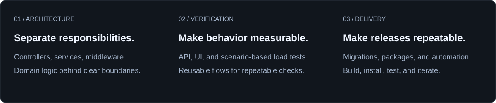</picture>

## Stack

<!-- STACK:START -->
**BACKEND & SYSTEMS**

<a href="https://isocpp.org/"><picture><source media="(prefers-color-scheme: light)" srcset="assets/stack/cplusplus-light.svg">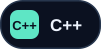</picture></a>
<a href="https://www.qt.io/"><picture><source media="(prefers-color-scheme: light)" srcset="assets/stack/qt-light.svg"></picture></a>
<a href="https://github.com/drogonframework/drogon"><picture><source media="(prefers-color-scheme: light)" srcset="assets/stack/drogon-light.svg"></picture></a>
<a href="https://go.dev/"><picture><source media="(prefers-color-scheme: light)" srcset="assets/stack/go-light.svg"></picture></a>
<a href="https://www.rust-lang.org/"><picture><source media="(prefers-color-scheme: light)" srcset="assets/stack/rust-light.svg"></picture></a>

**DATA & REAL-TIME**

<a href="https://www.postgresql.org/"><picture><source media="(prefers-color-scheme: light)" srcset="assets/stack/postgresql-light.svg"></picture></a>
<a href="https://www.sqlite.org/"><picture><source media="(prefers-color-scheme: light)" srcset="assets/stack/sqlite-light.svg"></picture></a>
<a href="https://drift.simonbinder.eu/"><picture><source media="(prefers-color-scheme: light)" srcset="assets/stack/drift-light.svg"></picture></a>
<a href="https://www.rfc-editor.org/rfc/rfc6455"><picture><source media="(prefers-color-scheme: light)" srcset="assets/stack/websocket-light.svg"></picture></a>
<a href="https://github.com/citusdata/pg_cron"><picture><source media="(prefers-color-scheme: light)" srcset="assets/stack/pgcron-light.svg"></picture></a>

**MOBILE & ARCHITECTURE**

<a href="https://flutter.dev/"><picture><source media="(prefers-color-scheme: light)" srcset="assets/stack/flutter-light.svg"></picture></a>
<a href="https://dart.dev/"><picture><source media="(prefers-color-scheme: light)" srcset="assets/stack/dart-light.svg"></picture></a>
<a href="https://bloclibrary.dev/"><picture><source media="(prefers-color-scheme: light)" srcset="assets/stack/bloc-light.svg"></picture></a>
<a href="https://pub.dev/packages/get_it"><picture><source media="(prefers-color-scheme: light)" srcset="assets/stack/getit-light.svg"></picture></a>

**DELIVERY & INFRASTRUCTURE**

<a href="https://www.kernel.org/"><picture><source media="(prefers-color-scheme: light)" srcset="assets/stack/linux-light.svg"></picture></a>
<a href="https://www.jenkins.io/"><picture><source media="(prefers-color-scheme: light)" srcset="assets/stack/jenkins-light.svg"></picture></a>
<a href="https://docs.gitlab.com/user/packages/package_registry/"><picture><source media="(prefers-color-scheme: light)" srcset="assets/stack/gitlab-light.svg"></picture></a>
<a href="https://www.docker.com/"><picture><source media="(prefers-color-scheme: light)" srcset="assets/stack/docker-light.svg"></picture></a>
<a href="https://www.debian.org/doc/manuals/maint-guide/"><picture><source media="(prefers-color-scheme: light)" srcset="assets/stack/debian-light.svg"></picture></a>
<a href="https://git-scm.com/"><picture><source media="(prefers-color-scheme: light)" srcset="assets/stack/git-light.svg"></picture></a>

**QUALITY & SECURITY**

<a href="https://playwright.dev/"><picture><source media="(prefers-color-scheme: light)" srcset="assets/stack/playwright-light.svg"></picture></a>
<a href="https://docs.flutter.dev/testing"><picture><source media="(prefers-color-scheme: light)" srcset="assets/stack/fluttertest-light.svg"></picture></a>
<a href="https://www.oasis-open.org/committees/pkcs11/"><picture><source media="(prefers-color-scheme: light)" srcset="assets/stack/pkcs11-light.svg"></picture></a>
<a href="https://www.rfc-editor.org/rfc/rfc8017"><picture><source media="(prefers-color-scheme: light)" srcset="assets/stack/rsa-light.svg"></picture></a>

<!-- STACK:END -->

## Activity

<a href="https://github.com/Parsania80?tab=overview"><picture><source media="(max-width: 640px) and (prefers-color-scheme: light)" srcset="assets/activity-mobile-light.svg"><source media="(max-width: 640px)" srcset="assets/activity-mobile-dark.svg"><source media="(prefers-color-scheme: light)" srcset="assets/activity-light.svg">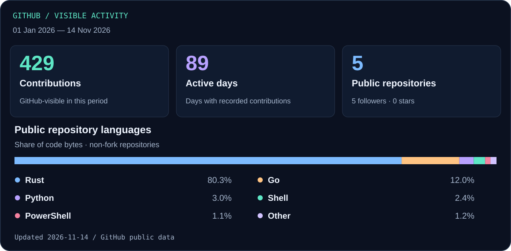</picture></a>

<a href="https://github.com/Parsania80?tab=overview"><picture><source media="(prefers-color-scheme: light)" srcset="assets/contributions-3d-light.svg">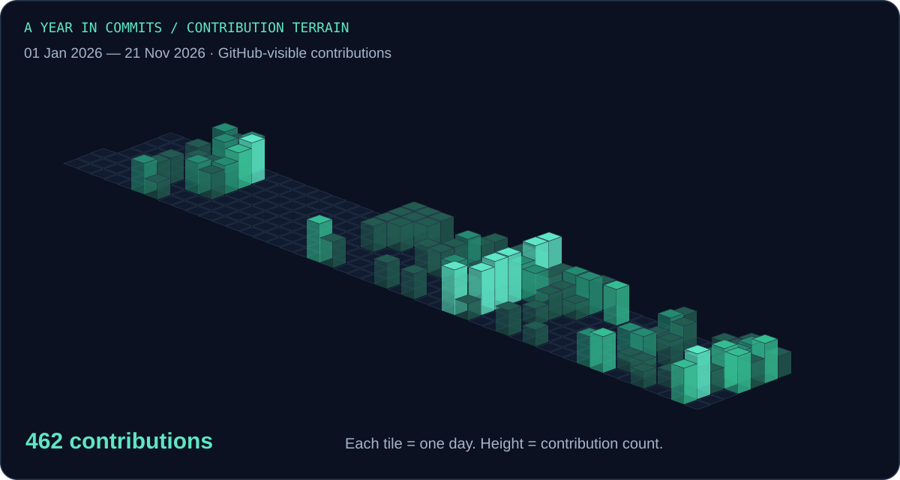</picture></a>

The calendar shows GitHub-visible activity. Language shares cover **public, non-fork GitHub repositories**; my private C++ company work and Flutter app are outside that language breakdown. Company GitLab activity is not counted.

## Let’s connect

Find me on [LinkedIn](https://www.linkedin.com/in/parsania80/), email me at [parsania80@gmail.com](mailto:parsania80@gmail.com), call [+98 939 600 3945](tel:+989396003945), or explore my [public projects](https://github.com/Parsania80?tab=repositories).

<picture>
  <source media="(prefers-color-scheme: light)" srcset="assets/footer-light.svg">
  
</picture>
